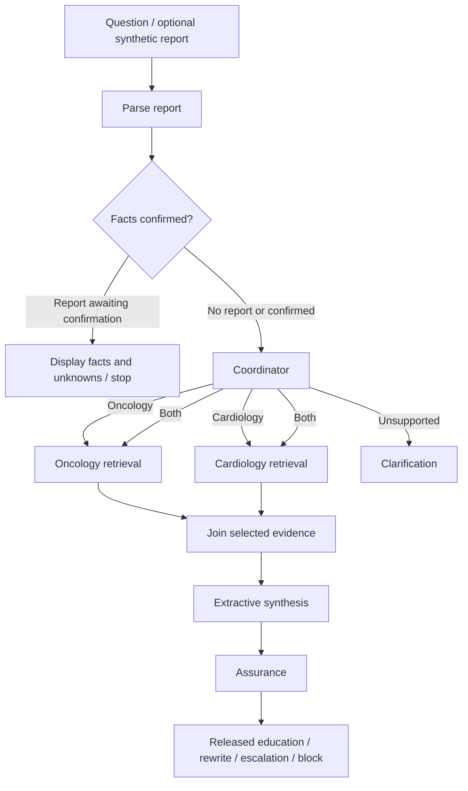

# CareGraph AI

A local educational application that makes a retrieval workflow visible. Ask an oncology or cardiology question, inspect the synthetic source excerpts, and follow the actual LangGraph nodes through retrieval, synthesis, and assurance. The CLI and Streamlit workspace use the same workflow.

New to the terminology? Read [RAG vocabulary and the CareGraph example](docs/RAG_Beginners_Guide.md), a short guide connecting tokens, chunks, embeddings, vector search, scores, FAISS storage, and citations.

**Synthetic education only.** This is a learning project, not a validated clinical system. Do not enter real patient data. It does not diagnose, infer stage, prescribe, or select treatment. The bundled references are original synthetic teaching content, not NCCN guidelines.

## Run on Windows

Use **Python 3.12** and PowerShell from the project directory. No paid API, API key, or external LLM account is needed. Initial dependency installation and model download need internet access.

With [uv](https://docs.astral.sh/uv/getting-started/installation/):

```powershell
uv sync --python 3.12 --locked
uv run python ingest.py
uv run streamlit run streamlit_app.py
```

Open <http://127.0.0.1:8501>. The server binds to loopback by default. Stop it with **Ctrl+C**.

The setup and launch helpers perform the same steps:

```powershell
.\scripts\setup.ps1
.\scripts\launch-ui.ps1
```

If script execution is restricted, run the individual commands above; changing PowerShell's execution policy is unnecessary.

Without uv:

```powershell
py -3.12 -m venv .venv
.\.venv\Scripts\python.exe -m pip install --upgrade pip
.\.venv\Scripts\python.exe -m pip install -r requirements.txt
.\.venv\Scripts\python.exe ingest.py
.\.venv\Scripts\python.exe -m streamlit run streamlit_app.py
```

The requirements export pins direct and transitive dependencies, including CPU PyTorch. The uv lock is the canonical environment. Activation is optional. If desired, run `.\.venv\Scripts\Activate.ps1`, then use `python` normally. Directly invoking the virtual environment's executable works when activation is blocked.

## Explore the workspace

1. Choose an example or enter an educational oncology/cardiology question.
2. Optionally upload a synthetic TXT/text-based PDF or load the bundled sample. Review the extracted values and unknown fields, then explicitly confirm them.
3. Select **Explore evidence**. Inspect the explanation, exact source excerpts, and execution trace in the result tabs.
4. Select **Clear session** to remove the question, report, and result from the workspace's session state.

The report remains in session memory and is never added to FAISS. New uploads reset confirmation. Reports must contain an explicit `SYNTHETIC REPORT` or `SYNTHETIC PATHOLOGY REPORT` label near the beginning. Recognized fields are tumor site, histology, grade, stage, tumor size, and biomarkers. Missing, blank, and “not provided” values remain unknown.

Reports are limited to 2 MiB, 20 PDF pages, 60,000 extracted characters, and 240 characters per extracted field. Unsupported, invalid, encrypted, image-only, ambiguously duplicated, and unlabeled reports are rejected. A synthetic label is a user assertion, not an automatic guarantee that a document is de-identified; only use fabricated data.

## Use the CLI

```powershell
uv run python app.py
uv run python app.py --question "What is a heart attack?"
uv run python app.py --question "What considerations apply to cancer plus heart disease?"
uv run python app.py --question "What is the weather?"
uv run python app.py --question "Choose my chemotherapy and dose"
uv run python app.py --question "What is oncology care?" --json
uv run python app.py --help
```

Preview a report first, then use the explicit confirmation flag after reviewing its fields:

```powershell
uv run python app.py --question "Which evidence is relevant to this tumor profile?" --report data/synthetic/sample_pathology_report.txt
uv run python app.py --question "Which evidence is relevant to this tumor profile?" --report data/synthetic/sample_pathology_report.txt --confirm-report
```

The interactive command displays report facts and asks for `CONFIRM` before retrieval. The CLI shows the selected route, executed nodes, changed state fields, retrieved counts, source IDs, and assurance decision. JSON output is intended for inspecting one local session; do not redirect report sessions to files if you want to retain the default memory-only lifecycle.

`.\scripts\launch-cli.ps1` also starts the interactive CLI; arguments are forwarded, for example:

```powershell
.\scripts\launch-cli.ps1 --question "What is oncology care?"
```

## Two separate pipelines

**Ingestion** runs only when explicitly requested. It reads the two approved synthetic reference filenames, preserves section/version lineage, chunks with overlap, creates normalized Sentence Transformers embeddings, and persists FAISS plus JSON metadata and integrity information. Sample reports and uploads are excluded by an explicit source allowlist.

```text
approved references → validate / chunk → embed → FAISS + provenance
                         ingest.py
```

**Questions** query the existing index. They embed the question and any confirmed report facts, retrieve domain-appropriate excerpts, assemble a deterministic extractive draft, and pass it through assurance.



For combined questions, both retrieval branches run in parallel. Reducers preserve concurrent evidence and trace updates; the selected branches finish before a single join and synthesis. Single-domain requests do not wait for an unselected branch. The runtime does not silently rebuild an absent or damaged index.

Every released factual excerpt is copied from retrieved evidence and identified by source filename, section, version, and chunk ID. Similarity is a ranking signal, **not clinical confidence**. A low-relevance or empty result does not justify an unrelated answer. Assurance compares the draft with the permitted evidence template; unsupported additions are rewritten from evidence and revalidated, or withheld. Clinical decisions and unsafe requests receive escalation/block outcomes.

## Model cache and offline use

The model is `sentence-transformers/all-MiniLM-L6-v2`, pinned to revision:

```text
c9745ed1d9f207416be6d2e6f8de32d1f16199bf
```

`ingest.py` downloads that revision to the local Hugging Face cache on first use. Ordinary runtime uses local model files only. After successful ingestion, CLI and UI retrieval work without internet access. Keep the model cache with the index; an index alone cannot embed a new question. If you remove the cache, rerun ingestion while online to restore it.

Index loading checks stored provenance, index integrity, model identity/revision, embedding dimensions, and current reference content. Missing, corrupt, incompatible, or stale artifacts produce an actionable setup error. Rebuild explicitly:

```powershell
uv run python ingest.py --rebuild
```

No Python pickle is used for index metadata. Do not manually edit generated index files. To change the knowledge library, update approved synthetic reference content and intentionally rerun ingestion.

## Observability and privacy

The local trace records node names, state-field changes, route, counts, source IDs, and redacted before/after summaries. There are no graph checkpoints, stored chat history, uploaded-report files, or feedback persistence. Streamlit browser usage telemetry is disabled. The in-process UI caches public model weights, not report data.

Cloud tracing is **off by default**, even if unrelated ambient LangChain/LangSmith tracing variables are set. The graph's input/output tracing is disabled. Optional LangSmith export requires both explicit application flags and sends only aggregate, redacted metadata:

```powershell
$env:CAREGRAPH_CLOUD_TRACING = "1"
$env:CAREGRAPH_SYNTHETIC_DATA_CONFIRMED = "1"
$env:LANGSMITH_API_KEY = "<your optional key>"
```

This optional feature requires connectivity and a LangSmith account; the application does not need it. The metadata export uses the `caregraph-synthetic` project. Raw questions, report bytes, extracted values, and evidence text are not exported. To return to local-only execution:

```powershell
Remove-Item Env:CAREGRAPH_CLOUD_TRACING -ErrorAction SilentlyContinue
Remove-Item Env:CAREGRAPH_SYNTHETIC_DATA_CONFIRMED -ErrorAction SilentlyContinue
```

`.env.example` documents the flags; setting shell variables is explicit. `.env`, indexes, local caches, uploads, secrets, and logs are gitignored.

## State example and glossary

Illustrative state before a combined question:

```json
{
  "question": "What considerations apply to cancer plus heart disease?",
  "domains": [],
  "evidence": [],
  "report_confirmed": false
}
```

After the retrieval join, both selected domains and their source IDs exist in the same runtime state. This compact illustration omits excerpt text:

```json
{
  "route": "both",
  "domains": ["oncology", "cardiology"],
  "evidence": [
    {"domain": "oncology", "source": "oncology_reference.txt", "chunk_id": "<stored chunk ID>"},
    {"domain": "cardiology", "source": "cardiology_reference.txt", "chunk_id": "<stored chunk ID>"}
  ],
  "executed_nodes": [
    "parse_report", "coordinator", "retrieve_oncology", "retrieve_cardiology",
    "join_evidence", "synthesis", "assurance"
  ],
  "decision": "release"
}
```

Parallel branch completion order can vary. The runtime UI trace provides the actual nodes and counts for each run.

| Term | Meaning in this application |
|---|---|
| Node = DO | A function that parses, routes, retrieves, synthesizes, or checks. |
| Edge = GO | A connection that schedules the next node. |
| Conditional edge = ROUTE | Selects node(s) from the coordinator's decision. |
| State = KNOW | Typed session values shared among nodes, with reducers for concurrent updates. |
| FAISS = INDEX | Persisted vectors and provenance, separate from graph state. |
| LangGraph = BUILD/RUN | Executes the workflow and parallel branches. |
| LangSmith = TRACE/EVALUATE | Optional metadata observation; disabled by default. |
| RAG | Retrieval plus grounded answer construction, not search alone. |

## Verify and extend

```powershell
uv run pytest -q
uv run python ingest.py
uv run python scripts/verify_acceptance.py
uv run python app.py --question "What is a heart attack?"
uv run python app.py --question "What considerations apply to cancer plus heart disease?"
uv run streamlit run streamlit_app.py
```

Fast tests inject a deterministic embedder while using real FAISS, so they do not download model weights. They cover routing, synchronization, provenance/integrity, report limits and confirmation, citation support, safety, tracing defaults, and unchanged index files across repeat queries/report use. `scripts/verify_acceptance.py` separately exercises the actual cached MiniLM model with socket connections blocked and verifies that runtime questions and reports preserve index bytes and modification times.

Key files:

```text
app.py                    CLI
streamlit_app.py          Local browser workspace
ingest.py                 Explicit reference ingestion
caregraph/state.py        Typed shared state and reducers
caregraph/graph.py        LangGraph nodes and edges
caregraph/retrieval.py    Embeddings, FAISS, provenance/integrity
caregraph/parsing.py      Bounded TXT/PDF extraction
caregraph/synthesis.py    Exact cited extractive template
caregraph/assurance.py    Scope, support, rewrite/revalidation
caregraph/trace.py        Redacted local and optional metadata trace
data/synthetic/           Approved references and sample reports
tests/                   Unit/integration acceptance coverage
docs/starter-pack/        Untouched source requirements and diagrams
```

The small corpus and deterministic intent rules demonstrate architecture, not clinical quality or comprehensive language understanding. External LLM generation, hybrid/OpenSearch search, feedback storage, licensed clinical sources, production validation, FHIR integrations, cloud deployment, A2A, and MCP remain deferred. Any future provider must preserve confirmation, provenance, scope checking, and data-lifetime boundaries rather than bypassing them.
